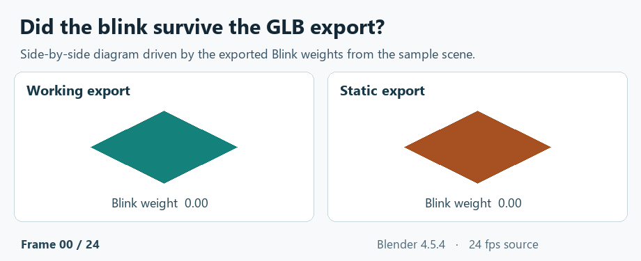

# Blender GLB Shape Check

Compare a named Blender shape key with the exported GLB animation, frame by frame. Locate a missing target, missing clip, missing weight channel or a motionless export.

**[Download v0.1.0 ZIP](https://github.com/Uone100/blender-glb-shape-check/releases/download/v0.1.0/blender-glb-shape-check-0.1.0.zip)** · **[English tutorial and worked examples](TUTORIAL.md)** · [All releases](https://github.com/Uone100/blender-glb-shape-check/releases)



## Install for Codex in one command

From your project, with Node.js 22.20 or newer:

```sh
npx skills add Uone100/blender-glb-shape-check -a codex
```

Start a new Codex session in that project. For standalone use, download the ZIP and follow the quickstart below.

## Quickstart

Extract the ZIP. Open a terminal in the folder containing `SKILL.md`.

With Blender 4.5 LTS or 5.2 on your PATH, generate the demo and check the exported blink.

```sh
blender -b --factory-startup --disable-autoexec --python-exit-code 2 -P examples/make_demo.py -- demo
blender -b --factory-startup --disable-autoexec demo/eyelid.blend --python-exit-code 2 -P scripts/check_shape.py -- demo/good.glb --object Eyelid --key Blink --clip Eyelid --frames 0 24
```

Look for `SHAPE_CHECK` followed by `status` equal to `match`. The tutorial runs the same comparison against two broken exports.

## Use with an agent

Put the extracted files under `.agents/skills/blender-glb-shape-check/` in a Codex project or `.claude/skills/blender-glb-shape-check/` in a Claude Code project. Start a new session. Try this request and supply your files:

> Compare Blink on my Eyelid mesh with the same expression in the exported Idle clip. Show the frame with the largest weight difference.

The [Godot puff animation report](https://www.reddit.com/r/godot/comments/1oi4y2i/shape_key_animation_not_exported_blender/) and [missing blink report](https://www.reddit.com/r/blenderhelp/comments/1sajfrr/gltfglb_export_shape_key_animation_not_included/) illustrate this handoff problem. The tool compares numerical shape-key weights over the chosen frame range.
